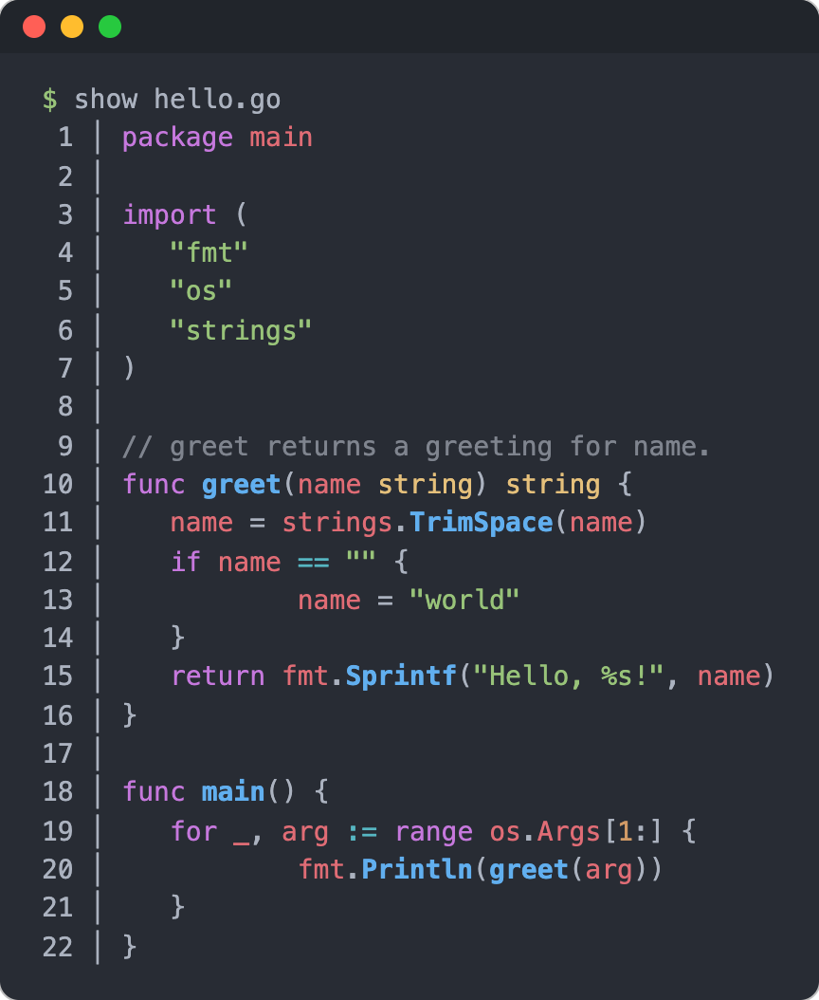

# show

[](https://github.com/tirtauntario/show-cli/actions/workflows/ci.yml)
[](https://github.com/tirtauntario/show-cli/releases)
[](https://pkg.go.dev/github.com/tirtauntario/show-cli)
[](#license)

`show <file>` prints a source file with syntax highlighting and line numbers,
then exits.



## Why

Sometimes I only want to read one source file, and starting Neovim for that
is more than I need. `cat` prints it without color. `show` prints it with
syntax highlighting picked automatically from the file name or contents, adds
line numbers, and exits.

## Install

With Go 1.22 or newer:

```sh
go install github.com/tirtauntario/show-cli/cmd/show@latest
```

Or download a prebuilt binary for Linux, macOS or Windows (amd64 and arm64)
from the [Releases](https://github.com/tirtauntario/show-cli/releases) page.
For example, on Linux x86_64:

```sh
curl -fsSL https://github.com/tirtauntario/show-cli/releases/latest/download/show_linux_amd64.tar.gz | tar -xz show
sudo mv show /usr/local/bin/
```

Replace `linux_amd64` with `darwin_arm64`, `darwin_amd64` or `linux_arm64` as
needed. Windows builds are `.zip` files.

Or build from source:

```sh
git clone https://github.com/tirtauntario/show-cli.git
cd show-cli
make build        # writes bin/show
```

## Usage

```sh
show main.go                      # highlight by file name
show -t yaml config.example       # force a file type when the name does not tell
show --theme github-dark main.go  # pick another theme
show main.go | less -R            # page through a long file
show --list-themes                # see the available themes
```

The file type is detected from the file name, then from the contents. Output
always contains ANSI color codes, also when piped, so use `less -R` to page.

## Options

| Flag | Description |
| --- | --- |
| `-t`, `--filetype <type>` | Force the file type, for example `go`, `python`, `yaml`. See `--list-file-types`. |
| `--theme <name>` | Set the color theme. Default: `onedark`. See `--list-themes`. |
| `-d`, `--debug` | Print the detected file type above and below the output. |
| `--list-file-types` | Print every value `--filetype` accepts, one per line. |
| `--list-themes` | Print every theme name, one per line. |
| `--install-completion <shell>` | Print a completion script for `bash`, `zsh` or `fish`. |
| `-v`, `--version` | Print the version. |
| `-h`, `--help` | Show help. |

Flags can go before or after the file name. Highlighting and themes come from
[Chroma](https://github.com/alecthomas/chroma), so any Chroma lexer or style
name works.

## Shell completion

```sh
# Bash
show --install-completion bash > ~/.local/share/bash-completion/completions/show

# Zsh (any directory in your $fpath)
show --install-completion zsh > "${fpath[1]}/_show"

# Fish
show --install-completion fish > ~/.config/fish/completions/show.fish
```

## Environment variables

| Variable | Effect |
| --- | --- |
| `NO_COLOR` | When set to a non-empty value, line numbers are printed without color. The code itself is still highlighted. |
| `LC_ALL`, `LC_CTYPE`, `LANG` | If any of them mentions UTF-8, the line number separator is `│`. Otherwise it is `\|`. |

## Roadmap

- Read defaults such as the theme from `~/.config/show/config.yaml`.
- A Homebrew formula.

Open an issue if you want to work on one of these.

## Contributing

Bug reports and pull requests are welcome. See [CONTRIBUTING.md](CONTRIBUTING.md)
for setup, tests and the release process.

## Acknowledgements

- Syntax highlighting: [Chroma](https://github.com/alecthomas/chroma)
- CLI framework: [urfave/cli](https://github.com/urfave/cli)

## License

Licensed under either of [Apache License, Version 2.0](LICENSE-APACHE) or
[MIT license](LICENSE-MIT), at your option.

Unless you explicitly state otherwise, any contribution intentionally
submitted for inclusion in this work by you, as defined in the Apache-2.0
license, shall be dual licensed as above, without any additional terms or
conditions.
